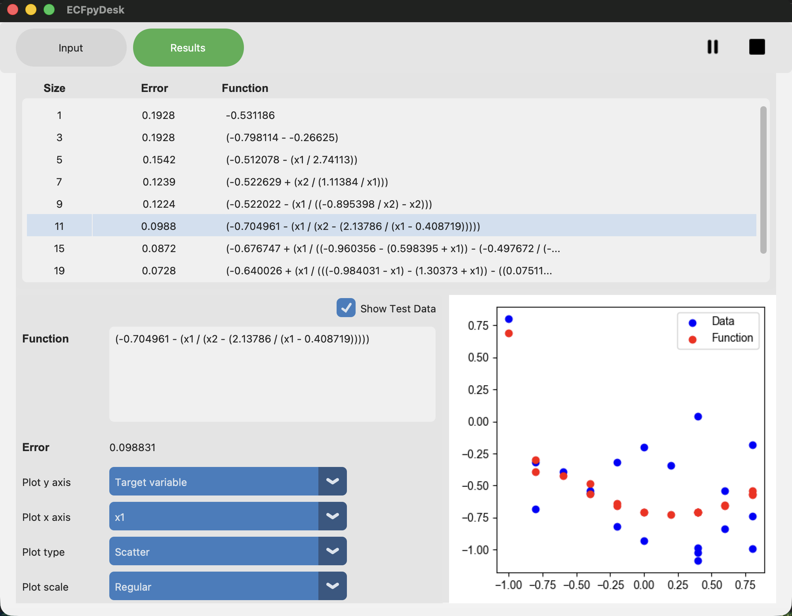

# ECFpyDesk

A desktop app for **symbolic regression**: give it a table of numbers and it searches for a mathematical expression that fits them, using evolutionary algorithms. You tick the functions and variables to use, press play, and read the best expressions off a Pareto front of size against error, with a plot of how each one fits.



*A short demo of a run: [docs/images/demo.mp4](docs/images/demo.mp4).*

## Who it is for

Students and researchers who want to try symbolic regression on a data set without writing C++ or editing parameter files by hand. It started as a master's thesis at FER and is handed over for use in teaching and research there.

## What it does

- Edit the search parameters on screen, with the starting values read from the parameter files, or edit the XML directly.
- Choose the terminal set from checkboxes, one per input variable found in your data, plus constants.
- Split the data into a train and a test set, and rank the results by the error on the test set.
- Run several searches at once (genetic programming, gene expression programming and analytical programming, drawn at 80%, 10% and 10%), and combine them into one Pareto front that refreshes while they run.
- Start, pause, continue and stop the run.
- Plot any expression on the train or test rows: the data against the expression, the residual or the residual in percent, against the row number or an input variable, as points or a line, on regular or logarithmic axes. The values are computed by the same program that ran the search.
- Hover tips on the input elements.

## Get it

**To use it:** download the package for Windows (x64) or macOS (Apple Silicon) from [Releases](../../releases), unpack it and start it. No Python or compiler is needed. The packages are not signed, so the first launch needs one extra click: the [user guide](docs/user-guide.md#1-start-the-app) shows how.

**To develop it:** clone the repository, build SRM and run from source. The [developer guide](docs/developer-guide.md) has every step. In short:

```bash
git clone https://github.com/jivancevic/ECFpyDesk.git
cd ECFpyDesk
cmake -S native -B build && cmake --build build --config Release --parallel 4
python3 -m venv venv && source venv/bin/activate
pip install -r requirements-dev.txt
python main.py
```

You need CMake 3.24 or newer, a C++ compiler and Python 3.14.

## Documentation

- [User guide](docs/user-guide.md): a walkthrough with the sample data, the input file format, reading the Pareto front and the plots, and the first-launch warnings.
- [Developer guide](docs/developer-guide.md): setup, tests, architecture, how to add a function or a parameter.
- [Building SRM](native/README.md), [glossary](GLOSSARY.md), [decisions](docs/adr/).

## Known limits

- **Windows was verified by CI only.** The build, the smoke run and the tests pass on Windows in CI, but no person has run the app on a Windows machine yet.
- Runs are not repeatable, even with a fixed seed.
- If the app is force-quit or crashes, its SRM processes may keep running.
- One window at a time, and very large input files are untested.

The full list is in the [user guide](docs/user-guide.md#6-known-limits).

## How it is built

A Python app (customtkinter, in the model–view–controller pattern) that drives **SRM**, a C++ program built on [ECF](https://ecf.readthedocs.io/), the Evolutionary Computation Framework. The app writes parameter files, starts SRM processes, reads their best individuals while they run and draws the results. Source of both parts is in this repository: `native/ecf` is ECF 1.6.1 with a small patch and `native/SRM` is SRM.

## Credits

- **Mentor:** prof. dr. sc. Domagoj Jakobović, who supervised the thesis.
- **Faculty of Electrical Engineering and Computing (FER), University of Zagreb**, where the thesis was written, 2024.
- **ECF**, the Evolutionary Computation Framework, and the people who built it, see its repository for the authors ([ecf.readthedocs.io](https://ecf.readthedocs.io/), [github.com/djakobovic/ECF](https://github.com/djakobovic/ECF)), under the MIT licence.
- **SRM**, the C++ program that runs symbolic regression on ECF, comes from D. Stanković, "Prilagodljivi programski sustav za simboličku regresiju" (An adaptable software system for symbolic regression), master's thesis, FER, University of Zagreb, 2016.
- **Author:** Josip Ivančević, "Programski sustav za simboličku regresiju", master's thesis in Software Engineering and Information Systems, FER, 2024.

## Licence

The MIT licence in `LICENSE` covers the whole repository, the Python app and SRM, except `native/ecf`: ECF has its own MIT licence in `native/ecf/license.txt`. SRM is published with the mentor's confirmation, see [ADR 0002](docs/adr/0002-publish-the-repo-with-srm-under-mit.md).
