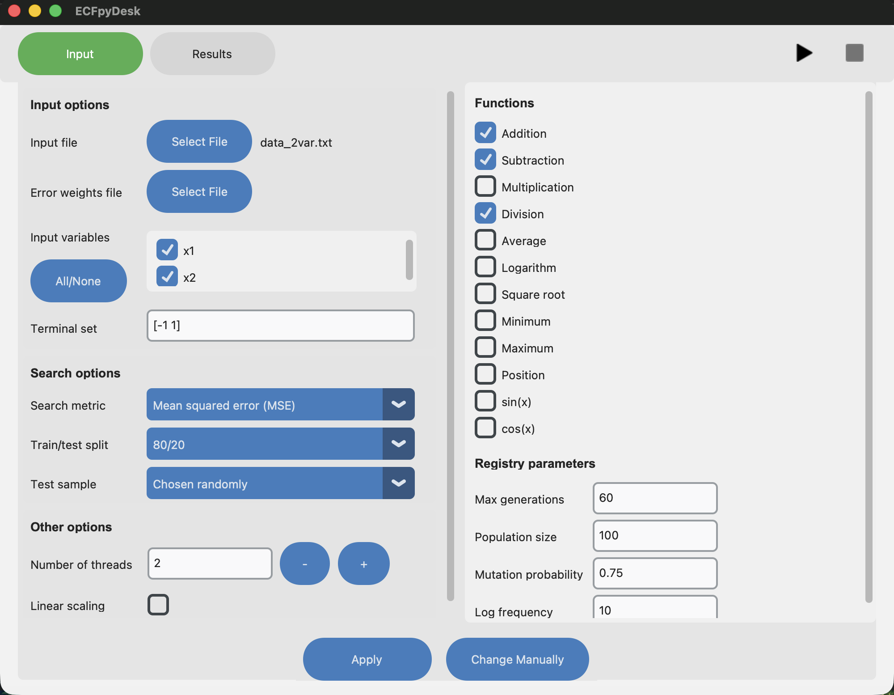
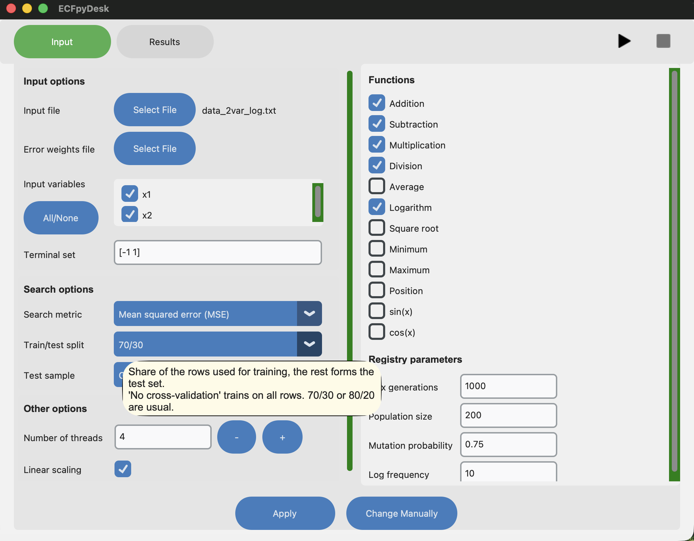
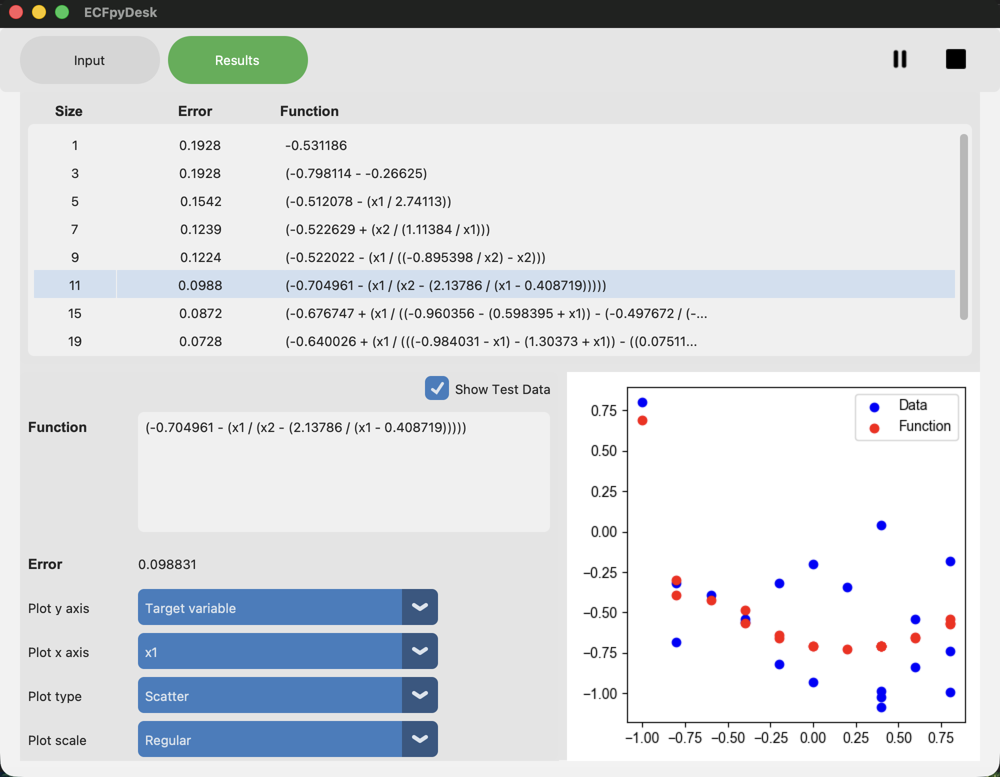
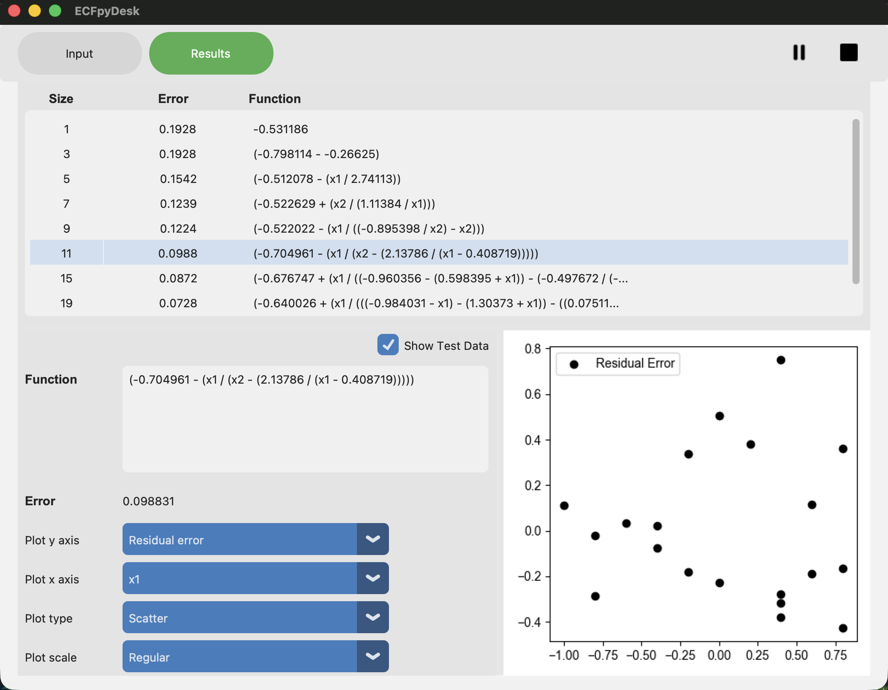

# User guide

ECFpyDesk looks for a mathematical expression that fits your data. This guide takes you from the first launch to reading the results, using the sample data that comes with the app. For installing from source or changing the program, see the [developer guide](developer-guide.md).

Contents: [Start the app](#1-start-the-app) · [Input data format](#2-input-data-format) · [Walkthrough](#3-walkthrough-with-the-sample-data) · [Reading the results](#4-reading-the-results) · [Settings reference](#5-settings-reference) · [Known limits](#6-known-limits)

## 1. Start the app

Download the package for your system from the project's GitHub Releases page: Windows (x64) or macOS (Apple Silicon). Unpack it and start `ECFpyDesk`. Nothing else needs to be installed.

The packages are **not signed**, because signing costs money. Windows and macOS therefore warn you the first time you open the app. The warning is expected, and you only have to deal with it once.

> **Maintainer note:** the steps below are written from how these warnings behave on current systems. The packaging change ships the exact file names and formats; check them against a real download and correct this section if they differ.

### macOS (Gatekeeper)

macOS says the app "cannot be opened" or that Apple "could not verify" it is free of malware. This is Gatekeeper reacting to an unsigned app downloaded from the internet.

1. Open the app once and dismiss the warning (choose **Done**, not **Move to Bin**).
2. Open **System Settings → Privacy & Security** and scroll down to **Security**. There is a line saying `ECFpyDesk` was blocked. Click **Open Anyway** and confirm with your password or Touch ID.
3. Open the app again and choose **Open**.

On macOS 14 and older, the shortcut is simpler: hold Control and click the app, choose **Open**, then **Open** again.

If you prefer the Terminal, this removes the quarantine mark that triggers the warning. Run it on the unpacked app (adjust the path):

```bash
xattr -dr com.apple.quarantine /path/to/ECFpyDesk.app
```

### Windows (SmartScreen)

Windows shows a blue **Windows protected your PC** window.

1. Click **More info**.
2. Click **Run anyway**.

If the app does not start at all, the downloaded zip may be blocked: right-click the zip, choose **Properties**, tick **Unblock** at the bottom, then unpack it again.

### Running from source

If you cloned the repository instead, none of this applies: see the [developer guide](developer-guide.md#1-get-it-running).

## 2. Input data format

A plain text file:

- one **row per sample**, no header line;
- values separated by **tabs** (spaces also work, but tabs are the convention);
- the **last column is the target**, the value the expression should predict;
- the columns before it are the **input variables**, named `x1`, `x2` and so on in the order they appear;
- numbers use a decimal point; empty lines are ignored.

For example, `srm/data_2var.txt`, with variables `x1` and `x2` and target `x1 * x2`:

```
-1	-1	1
-1	-0.8	0.8
-1	-0.6	0.6
```

The app reads the number of variables from the first row and offers a checkbox for each.

**Error weights file (optional).** A file with one number per row of the input file, in the same order. A larger weight makes errors on that sample count more. Leave it unset to weigh all samples equally.

## 3. Walkthrough with the sample data

The folder `srm/` has three sample files:

| File | Variables | The target is |
| --- | --- | --- |
| `data_1var.txt` | `x1` | `3 * x1` |
| `data_2var.txt` | `x1`, `x2` | `x1 * x2` |
| `data_2var_log.txt` | `x1`, `x2` | `log(x1) / log(x2)` |

We use `data_2var.txt`: 100 rows, target `x1 * x2`. To make the search interesting we take away the easy answer: the pictures below come from a deliberately hard setup in which multiplication is switched off, so no expression can reproduce the data exactly and the Pareto front shows a real trade-off. (With multiplication available, this sample is easy, and so is the 15-row `data_2var_log.txt`: both get an exact answer within seconds.) In the packaged app, the sample data is inside the app bundle; you can also copy the files from the repository. Any file in the format above works.

### Step 1: set up the Input screen



1. **Input file → Select File**, and pick `data_2var.txt`. The file name appears next to the button, and one checkbox per variable (`x1`, `x2`) appears under **Input variables**. Both are ticked.
2. **Terminal set** holds the constants an expression may use besides the ticked variables. `[-1 1]` means random constants between -1 and 1. Leave it.
3. **Search options.** Leave **Search metric** on mean squared error. Set **Train/test split** to **80/20**: the search sees 80% of the rows, and the remaining 20% (the *test set*) is kept to judge the results. **Test sample → Chosen randomly** picks those rows at random.
4. **Number of threads** is the number of SRM processes that run side by side, each searching on its own. Set it to 2 here (the **+** button stops at the number of cores your machine has).
5. On the right, under **Functions**, tick the operations expressions may use. For this walkthrough, untick **Multiplication** and **Logarithm**, leaving addition, subtraction and division. Under **Registry parameters** are the search settings: set **Max generations** to 60 and **Population size** to 100, a small and quick search. For a real problem, keep the defaults or go larger.
6. Untick **Linear scaling**. It needs addition and multiplication, so with multiplication off the app would refuse to start a run until you do. With it on, every expression is wrapped as `offset + factor * (...)`, which fits a scale and an offset for free; with it off you see the raw expressions as in the pictures.

**Apply** saves what is on screen as the starting point for the next launch. You do not have to press it: a run always uses what is on screen. **Change Manually** swaps the screen for the raw parameter file (XML), for options the screen does not list; **Save** keeps your edit, **Back** returns.

**Hover tips.** Rest the mouse on almost any label, field or button to see what it does and a sensible range of values:



### Step 2: start the run

Press the **play** button at the top right. The app starts the processes (each draws its algorithm at random: genetic programming 80%, gene expression programming 10%, analytical programming 10%) and switches you to the Results tab.

- **Pause** (the same button, now showing two bars) freezes all processes, and the same button continues them.
- **Stop** (the square) ends the run. Starting again clears the results.

A process that finishes its generations starts again by itself, so results keep improving until you press Stop. In this setup the front improves over the first half minute and then creeps.

### Step 3: read the results



The front runs from `-0.531186` (a single constant, error 0.1928) to a size-19 expression with error 0.0728: each step up in size buys a smaller error, with diminishing returns. The chosen row (size 11, error 0.0988, measured on the test rows) is plotted against `x1`, with the data in blue and the expression in red. Where only red is visible, the expression hits the data. The next section explains each part. Your own run will show different numbers: searches are random.

## 4. Reading the results

### The Pareto front

The list at the top is the **Pareto front** across all processes: expressions that no other expression beats on both **Size** and **Error**. Size is the number of nodes in the expression, so it is a measure of complexity. A big expression can always fit a little better, so the front shows the best error for each size you might be willing to accept, and you choose the trade-off:

- the top rows are small and simple, the bottom rows are larger and (a little) more accurate;
- the first row whose error is "good enough" for your purpose is usually the one to take.

The list refreshes while the run goes on (every half a second by default). The **Error** is measured with the search metric you chose. When you picked a train/test split, the front is ranked by the **test error**, which says how well an expression does on rows the search never saw. That is the honest number, since an expression can fit its training rows by memorising them.

Click a row, or use the up and down arrow keys, to select an expression. Its full text shows under **Function**, with its error, and the plot shows how it fits.

### The plot

The plot is drawn from values computed by SRM itself, so it shows exactly what the search saw. Use the options under the expression:

| Option | Choices |
| --- | --- |
| **Plot y axis** | **Target variable**: the data (blue) and the expression (red); **Residual error**: data minus expression; **Residual error (%)**: the absolute residual relative to the data |
| **Plot x axis** | **Row number**, or one of the input variables |
| **Plot type** | **Scatter**, or **Line** (joined in order of the x axis) |
| **Plot scale** | **Regular**, **log y**, **log x**, **log x and log y** (log scales need positive values) |
| **Show Test Data** | tick to plot the test rows instead of the training rows (appears when you chose a split) |

With the target plotted, a blue dot hidden under a red one means the expression fits there; a gap between them is a miss. The residual plot shows the misses directly, as data minus expression:



### Tips

- Run the search for a while, then look at the front: expressions that appear repeatedly at the same size are likely real structure, not luck.
- If the front has many nearly equal errors, compare the sizes: the smallest one with a good error is usually the best explanation.
- More threads means more independent searches, so a better front for the same waiting time.
- With linear scaling on, every expression is shown wrapped in an offset and a factor, for example `-4.15698e-07 + 1.00001 * (log(x1) / log(x2))`. Read it as "`log(x1) / log(x2)`, with a scale of about 1 and an offset of about 0".

## 5. Settings reference

| Setting | Meaning |
| --- | --- |
| Input file | The data, see [format](#2-input-data-format) |
| Error weights file | Optional weight of each row's error |
| Input variables | Which columns the expressions may use |
| Terminal set | Constants in addition to the variables; `[a b]` is a random constant between `a` and `b` |
| Search metric | MSE (punishes big misses), MAE (robust to outliers), MAPE (relative error; avoid targets near 0) |
| Train/test split | Share of rows used for training; "No cross-validation" uses all rows and there is no test set |
| Test sample | Test rows chosen at random, or the last rows in file order |
| Number of threads | SRM processes running at once |
| Linear scaling | Fit a scale and an offset to each expression; needs addition and multiplication |
| Functions | The operations expressions are built from |
| Max generations | Generation limit of one SRM run; stagnation and evaluation limits also end a run |
| Population size | Expressions per process |
| Mutation probability | Chance an expression is mutated, 0 to 1 |
| Log frequency | Every this many generations the best expression is written out and shown; above 0 |

Division, logarithm and square root are *protected*: division returns 1 when the divisor is close to 0, and logarithm (base 10) and square root return 0 for values that are not positive. This keeps every expression computable.

### Where the app keeps your settings

Settings saved with **Apply** and the working files of a run go to a per-user folder: `~/Library/Application Support/ECFpyDesk` on macOS, `%LOCALAPPDATA%\ECFpyDesk` on Windows. Delete it to start from the defaults.

## 6. Known limits

- **Windows was verified by CI only.** Nobody has run the Windows build on a Windows machine yet: the automated tests and the smoke run pass there, but no person has clicked through the app. If something misbehaves on Windows, that is the first place to look.
- **Linux** builds and passes the tests in CI, and runs from source. There is no Linux package.
- **Runs are not repeatable.** A fixed `randomizer.seed` does not make two runs equal, because part of the search draws from a source the seed does not control. Different runs give different, similarly good, fronts.
- **Closing the window ends SRM, a crash does not.** If the app is force-quit or crashes, SRM may keep running (or stay stopped, if the run was paused). End it from the Task Manager or Activity Monitor.
- **One window at a time.** Two windows share the working folder, and the second clears it.
- **Stop interrupts an evaluation in progress.** The individual being evaluated at that moment is left without a test error.
- **"Change Manually" edits only the GP template.** The GEP and AP templates (about 20% of processes) and the evaluation file do not get the edit. Values set on the screen reach all of them.
- **Large input files are untested.** Plotting evaluates on the main thread, so the window pauses while SRM evaluates a very large file.
- The app and SRM are a thesis project: no new features are planned.
